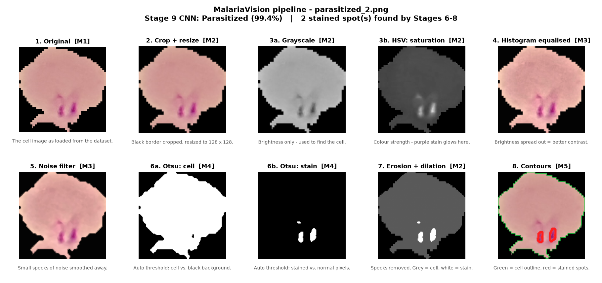
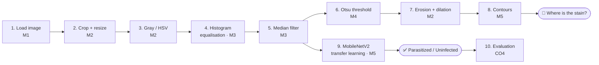
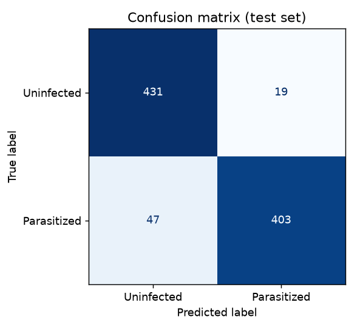
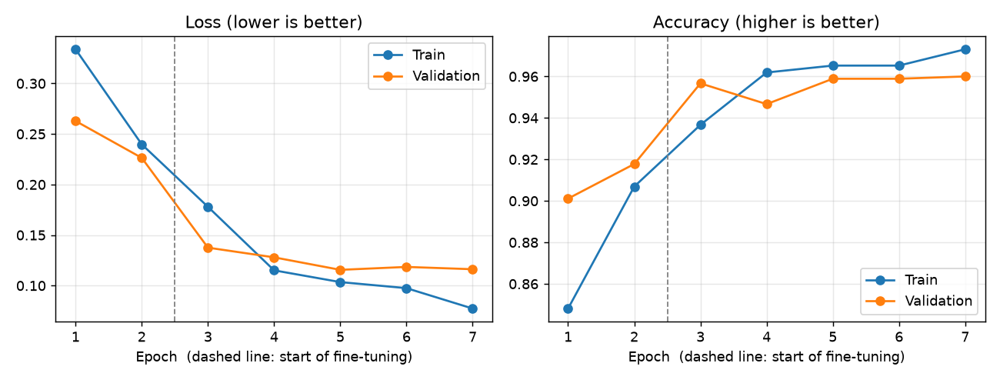
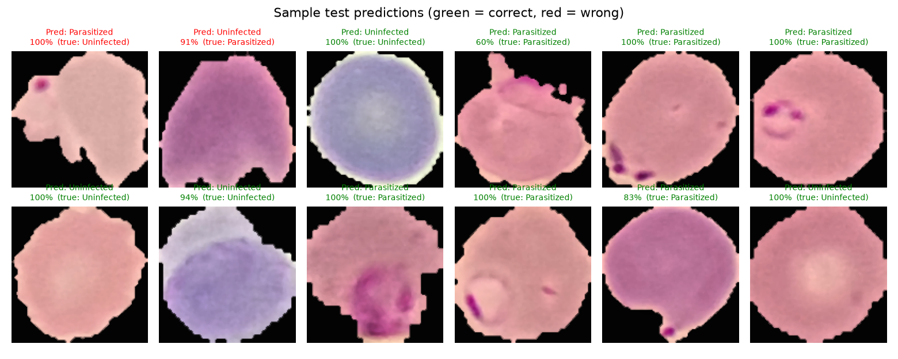
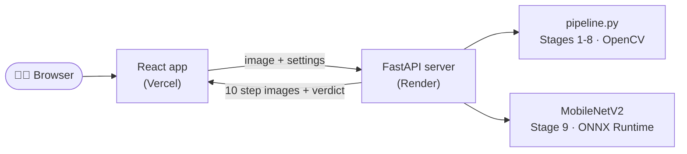
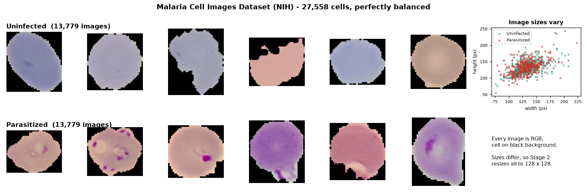

<div align="center">

# 🔬 MalariaVision

### Malaria parasite detection from blood-smear images using image processing and transfer learning


**Project-based learning · Fundamental of Image Processing and Computer Vision Lab (26B16CS316) · 2026-27**



</div>

---

## 🩸 The problem in 30 seconds

Malaria is confirmed by a technician who looks at a stained blood smear under a microscope and checks the cells one by one. That is slow and tiring, and a tired eye can miss an infected cell.

The parasite shows up as a **dark purple spot** inside the red blood cell (the Giemsa stain colours it). MalariaVision looks at a single cell image and:

1. **cleans** it with classical image processing,
2. **points to** the suspicious stained spot (Otsu thresholding, morphology, contours), and
3. **decides** *Parasitized* or *Uninfected* with a pre-trained CNN (transfer learning).

Every technique comes from the lab syllabus (Modules 1 to 5).

---

## 🧭 How it works



| # | Stage | What it does, in plain words | Technique | Module |
|:-:|-------|------------------------------|-----------|:------:|
| 1 | Load | Read the microscope image and display it | `cv2.imread`, Matplotlib | **M1** |
| 2 | Crop + resize | Cut off the black border, make every image 128 × 128 | Bounding box, `cv2.resize` | **M2** |
| 3 | Colour spaces | Grayscale for brightness; HSV saturation makes the purple stain glow | `cv2.cvtColor` | **M2** |
| 4 | Enhancement | Spread brightness out so every slide has similar contrast | CLAHE histogram equalisation (V channel) | **M3** |
| 5 | Noise removal | Remove tiny specks while keeping edges sharp | Median filter (Gaussian / Average selectable) | **M3** |
| 6 | Segmentation | Pick thresholds automatically: cell vs. background, then stained vs. normal | Otsu thresholding | **M4** |
| 7 | Mask cleanup | Delete small noisy dots, keep the real regions | Erosion + dilation | **M2** |
| 8 | Region detection | Outline the cell (green) and the stained spots (red) | Contour detection, convex hull | **M5** |
| 9 | Classification | Re-use a network trained on 1.2 M photos; retrain its last layers for our task | MobileNetV2 transfer learning, flip/rotate augmentation | **M5** (+M2) |
| 10 | Evaluation | Test on images the model has never seen | Accuracy, precision, recall, F1, confusion matrix | **CO4** |

---

## 📊 Results (prototype v0.1)

Tested on **900 cell images the model never saw** during training (balanced subset of 6,000 images, 12 minutes on a laptop CPU):

<div align="center">

| Accuracy | Precision | Recall | F1-score | Missed infections |
|:--------:|:---------:|:------:|:--------:|:-----------------:|
| **96.3%** | **97.5%** | **95.1%** | **96.3%** | 22 of 450 |

 

</div>

**What changed since the first run.** We kept our first attempt as a baseline and improved it step by step:

| Version | Stage 4 enhancement | Fine-tuning | Accuracy | Recall | Missed infections |
|---------|---------------------|-------------|:--------:|:------:|:-----------------:|
| Baseline | Plain `equalizeHist` | 3 epochs, last 5 blocks | 92.7% | 89.6% | 47 |
| **v0.1** | **CLAHE** | **5 epochs, last 8 blocks** | **96.3%** | **95.1%** | **22** |

Plain histogram equalisation stretched each cell's darkest pixels to almost black, which hurt both Otsu and the CNN. CLAHE (still Module 3) limits the contrast boost and fixed it.

**Stain-spot highlighting (Stages 6-8)**, measured on 800 random cells: a spot is outlined in **87%** of infected cells and wrongly outlined in only **3%** of healthy ones.



---

## 🖥️ Web app

A React web app shows the whole pipeline live, in three tabs:

- **🔍 Live diagnosis**: pick one of 12 test-set cells (or drag in your own image) and see all 10 stages, the stained-spot outline, the brightness histograms, the thresholds Otsu chose and the CNN's verdict. Switch the noise filter (Median / Gaussian / Average) and kernel sizes to see how each stage reacts.
- **📊 Model performance**: accuracy, precision, recall and F1 compared with our first run, the confusion matrix and the training curves.
- **🗺️ Syllabus map**: every stage mapped to its module and course outcome.

### Architecture



All image processing runs in **Python with OpenCV** on the server (`pipeline.py`, the same code used for training). React only displays the results. The trained PyTorch model is exported to **ONNX** (`export_onnx.py`), so the free server can run it without loading the whole of PyTorch. The export is checked against PyTorch on every sample: the largest difference is 0.0000002.

> The free Render server sleeps after 15 minutes without visitors, so the first visit can take up to a minute while it wakes up. Open the site a minute before a demo.

A Streamlit version of the demo (`app.py`) is kept as a one-command backup that needs no Node.js.

---

## 🚀 Quick start

**1. Clone and install** (Python 3.11 recommended)

```bash
git clone https://github.com/Shiva-Preetham/Image-Processing-CV-PBL.git
cd Image-Processing-CV-PBL
python -m venv .venv
```

```bash
.venv\Scripts\activate            # Windows
# source .venv/bin/activate      # macOS / Linux
pip install -r requirements.txt
```

**2. Run the web app.** The trained model and 12 sample cells are already in the repo. Start the API in one terminal:

```bash
uvicorn backend.main:app --reload --port 8000
```

Then the React app in a second terminal (needs Node.js 20.19+), and open http://localhost:5173:

```bash
cd frontend && npm install && npm run dev
```

Quick alternative with Python only: `streamlit run app.py`.

**3. (Optional) Download the dataset to re-train** (337 MB, official NIH source)

```powershell
# Windows PowerShell
Invoke-WebRequest https://data.lhncbc.nlm.nih.gov/public/Malaria/cell_images.zip -OutFile data/cell_images.zip
Expand-Archive data/cell_images.zip -DestinationPath data
```

```bash
# macOS / Linux
mkdir -p data && curl -L -o data/cell_images.zip https://data.lhncbc.nlm.nih.gov/public/Malaria/cell_images.zip
unzip -q data/cell_images.zip -d data
```

**4. Train, evaluate and regenerate the figures**

```bash
python train.py                  # prototype: 3,000 images per class (~12 min on a laptop CPU)
python train.py --per-class 0    # full dataset: all 27,558 images
python make_figures.py           # dataset overview + per-stage pipeline figures
python export_onnx.py            # refresh the ONNX model used by the web server
python -m pytest tests -q        # API checks
```

---

## ☁️ Deployment

| Part | Host | Config |
|------|------|--------|
| API (`backend/`) | [Render](https://render.com) free web service | [`render.yaml`](render.yaml) |
| Web app (`frontend/`) | [Vercel](https://vercel.com) | Vite preset, root directory `frontend` |

1. **Render**: *New → Blueprint →* pick this repository *→ Apply*. Render reads `render.yaml`, installs `backend/requirements.txt` (no PyTorch) and starts the API. Check `https://<your-service>.onrender.com/api/health`.
2. **Vercel**: *Add New → Project →* import this repository, set **Root Directory** to `frontend`, keep the Vite preset and deploy. If your Render URL is not `https://malariavision-api.onrender.com`, add an environment variable `VITE_API_URL` with your Render URL before deploying.

Both redeploy automatically on every push to `main`.

---

## 📁 Project structure

```
├── pipeline.py          Stages 1-8  classical image processing (each function tagged with its module)
├── classifier.py        Stage 9     MobileNetV2 transfer learning + flip/rotate augmentation
├── train.py             Stages 9-10 two-phase training and test-set evaluation
├── export_onnx.py       exports the trained model to ONNX and checks it matches PyTorch
├── make_figures.py      figures for the report and viva
├── backend/             FastAPI server: runs pipeline.py + the ONNX model for the web app
├── frontend/            React (Vite) web app
├── app.py               Streamlit version of the demo (backup)
├── tests/               API checks (pytest)
├── FACULTY_GUIDE.md     5-minute talk track, demo script and viva Q&A
├── models/              trained weights: PyTorch (.pt) and ONNX (.onnx), ~9 MB each
├── samples/             12 test-set cells used by the demo
├── outputs/             metrics.json, confusion matrix, curves, pipeline figures, training log
├── render.yaml          Render deployment for the API
└── requirements.txt     everything for local training and development
```

---

## 🗂️ Dataset

**Malaria Cell Images Dataset** from the U.S. National Library of Medicine (NIH / LHNCBC): 27,558 single-cell images from Giemsa-stained thin blood smears, **13,779 parasitized** and **13,779 uninfected**.



Split used: 70% train, 15% validation, 15% test (stratified, seed 42). Test images are never used during training.

---

## 🎯 Course outcome mapping

| CO | What the project shows |
|----|------------------------|
| **CO1** | Image loading, display, saving, resizing, cropping and colour-space conversion |
| **CO2** | Histogram enhancement, spatial filtering, thresholding and morphology |
| **CO3** | Contour detection and CNN-based recognition with transfer learning |
| **CO4** | A healthcare application, built end to end and evaluated with standard metrics |

---

## 🛣️ Roadmap

- [x] **v0.1 prototype**: full 10-stage pipeline, trained model, demo app, report figures
- [ ] Faculty review and feedback
- [ ] **v0.2**: improvements from the feedback (candidates: train on the full dataset, adaptive thresholding for unevenly stained cells, a Jupyter notebook version for submission)
- [ ] Final report and viva

---

## 👥 Team

| Name | Enrollment No. |
|------|----------------|
| Lakshita Gautam | 23103343 |
| Ranjeet Kaur | 2401030065 |
| Navya Banga | 2401030070 |
| Shiva Preetham Chelimila | 2401030078 |

**Faculty:** Ms. Neha · Dr. Pawan Kumar Upadhyay

---

## 📚 References

- Rajaraman S., Antani S. K., Poostchi M., *et al.* "Pre-trained convolutional neural networks as feature extractors toward improved malaria parasite detection in thin blood smear images." *PeerJ* 6:e4568, 2018. (Source of the dataset.)
- Sandler M., Howard A., Zhu M., Zhmoginov A., Chen L.-C. "MobileNetV2: Inverted Residuals and Linear Bottlenecks." *CVPR*, 2018.
- Otsu N. "A Threshold Selection Method from Gray-Level Histograms." *IEEE Trans. SMC* 9(1), 1979.
- Gonzalez R. C., Woods R. E. *Digital Image Processing*, 4th ed., Pearson, 2018.
